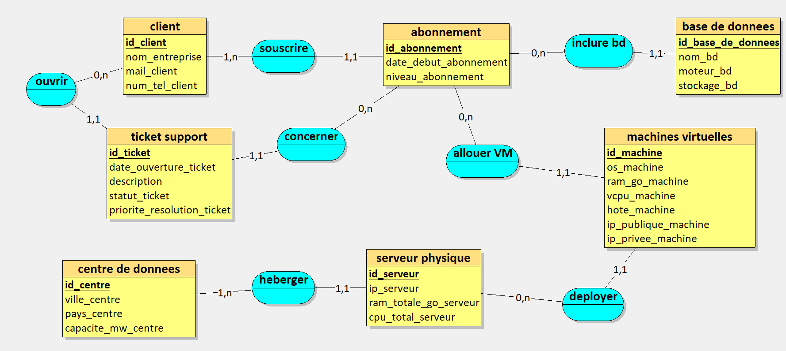
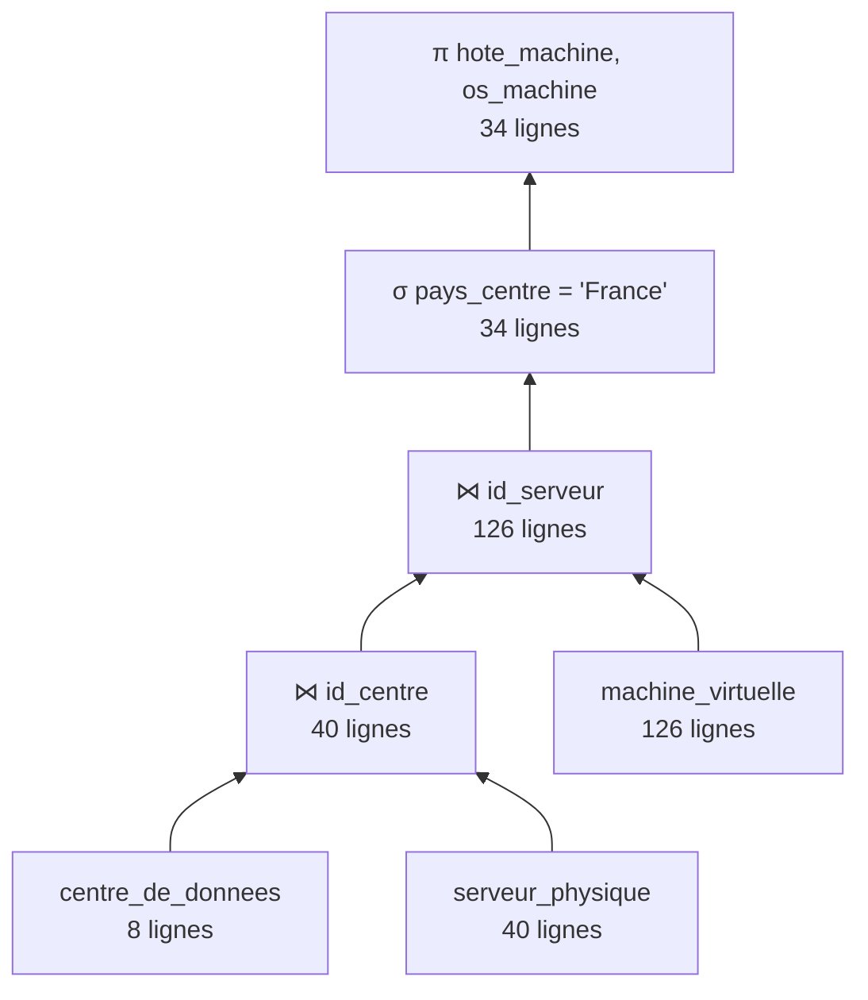
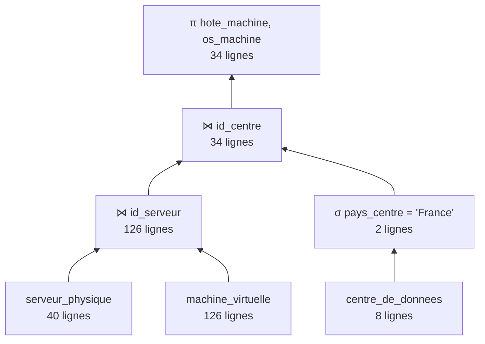
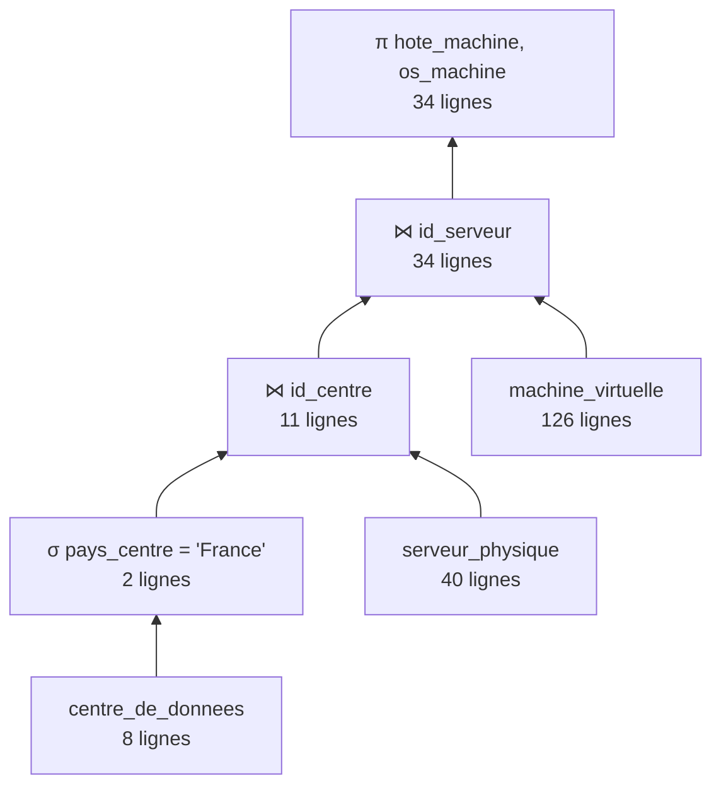

# ☁️ Conception d'un Système d'Information : Fournisseur Cloud (IaaS / PaaS)

[](#)
[](#)
[](#)
[](#)

Ce dépôt contient les **Parties 1 et 2** du mini-projet de conception et développement de base de données (Module TI503N) : de l'analyse des besoins jusqu'à la base MySQL remplie et interrogée.

L'objectif de cette première phase est de modéliser le système d'information d'un **fournisseur de services de Cloud Computing** (inspiré de Microsoft Azure et OVHcloud), en analysant les besoins métiers pour aboutir à un Modèle Conceptuel de Données (MCD) robuste et normalisé. Ce domaine métier implique la gestion complexe d'infrastructures physiques (Data Centers, serveurs) allouées dynamiquement sous forme de ressources virtuelles (VM, BDD) aux clients.

---

## 📑 Sommaire
- [Étape 1 : Analyse des besoins](#-étape-1--analyse-des-besoins)
  - [Génération des besoins via IAG (Prompt)](#génération-des-besoins-via-iag-prompt)
  - [Règles de Gestion Métier](#règles-de-gestion-métier)
  - [Dictionnaire de Données Brutes](#dictionnaire-de-données-brutes)
- [Étape 2 : Modèle Conceptuel de Données (MCD)](#-étape-2--modèle-conceptuel-de-données-mcd)
  - [Diagramme MCD](#diagramme-mcd)
  - [Justification des choix de modélisation (Modélisation Avancée)](#justification-des-choix-de-modélisation-modélisation-avancée)
- [Étape 3 : MLD et MPD](#-étape-3--mld-et-mpd)
  - [Modèle Logique de Données (MLD)](#modèle-logique-de-données-mld)
  - [Modèle Physique de Données (MPD) — MySQL](#modèle-physique-de-données-mpd--mysql)
- [Étape 4 : Insertion des données](#-étape-4--insertion-des-données)
- [Étape 5 : Interrogation de la base](#-étape-5--interrogation-de-la-base)
  - [Scénario d'utilisation](#scénario-dutilisation)
  - [Étude des plans d'exécution](#étude-des-plans-dexécution)
- [Bilan critique](#-bilan-critique)

---

## 🔍 Étape 1 : Analyse des besoins

### Génération des besoins via IAG (Prompt)
Pour simuler la collecte des besoins auprès du métier, nous avons conçu un prompt basé sur le **framework RICARDO** (Rôle, Instructions, Contexte, Contraintes, Références, Désiré, Objectifs).

<details>
<summary><b>👉 Cliquer ici pour voir le prompt utilisé</b></summary>
<br>

> Tu travailles dans le domaine du Cloud Computing et de l'hébergement d'infrastructures informatiques. Ton entreprise a comme activité de fournir des ressources de calcul, des bases de données managées et des espaces de stockage à la demande pour d'autres entreprises. C’est une entreprise comme Microsoft Azure, AWS, Google Cloud ou OVHcloud. Les données ont été collectées sur les clients professionnels, les centres de données physiques, les serveurs, les machines virtuelles déployées, les abonnements de facturation et les tickets de support technique. Inspire-toi du site web officiel et de la documentation technique de Microsoft Azure.
>
> Ton entreprise veut appliquer MERISE pour concevoir un système d'information. Tu es chargé de la partie analyse, c’est-à-dire de collecter les besoins auprès de l’entreprise. Elle a fait appel à un étudiant en ingénierie informatique pour réaliser ce projet, tu dois lui fournir les informations nécessaires pour qu’il applique ensuite lui-même les étapes suivantes de conception et développement de la base de données.
>
> D’abord, établis les règles de gestions des données de ton entreprise, sous la forme d'une liste à puce. Elle doit correspondre aux informations que fournit quelqu’un qui connaît le fonctionnement de l’entreprise, mais pas comment se construit un système d’information.
>
> Ensuite, à partir de ces règles, fournis un dictionnaire de données brutes avec les colonnes suivantes, regroupées dans un tableau : signification de la donnée, type, taille en nombre de caractères ou de chiffres. Il doit y avoir entre 25 et 35 données. Il sert à fournir des informations supplémentaires sur chaque donnée (taille et type) mais sans a priori sur comment les données vont être modélisées ensuite.
>
> Fournis donc les règles de gestion et le dictionnaire de données.
</details>

### Règles de Gestion Métier
Suite à l'analyse, voici les règles opérationnelles qui régissent le fonctionnement de notre infrastructure d'hébergement :

- **RG01** : Un client professionnel peut souscrire à un ou plusieurs abonnements de facturation.
- **RG02** : Chaque abonnement appartient à un seul client et définit un niveau de service (ex: Standard, Premium).
- **RG03** : Notre infrastructure s'appuie sur plusieurs centres de données (Data Centers) répartis dans différentes villes et pays.
- **RG04** : Un centre de données héberge de nombreux serveurs physiques.
- **RG05** : Un serveur physique ne peut se trouver que dans un seul centre de données à la fois.
- **RG06** : Sur un même serveur physique, notre hyperviseur peut déployer plusieurs machines virtuelles (VM).
- **RG07** : Chaque machine virtuelle est allouée à un abonnement client spécifique (qui prend en charge la facturation).
- **RG08** : Une machine virtuelle utilise un système d'exploitation donné (Windows Server, Ubuntu, RedHat, etc.) et se voit allouer une certaine quantité de ressources (RAM et vCPU).
- **RG09** : Dans le cadre des services PaaS, un abonnement peut également inclure une ou plusieurs bases de données managées (SQL ou NoSQL).
- **RG10** : En cas de problème technique ou administratif, un client peut ouvrir des tickets de support.
- **RG11** : Chaque ticket de support est rattaché à un client spécifique et concerne un abonnement précis.
- **RG12** : Un ticket de support possède un niveau de priorité (Basse, Normale, Haute, Critique) et un statut d'avancement.

### Dictionnaire de Données Brutes

| Code Donnée | Signification | Type | Taille |
| :--- | :--- | :--- | :--- |
| `id_client` | Identifiant unique du client | Entier | 8 |
| `nom_entreprise` | Nom de l'entreprise cliente | Alphanumérique | 100 |
| `mail_client` | Adresse e-mail de contact du client | Alphanumérique | 150 |
| `num_tel_client` | Numéro de téléphone du client | Alphanumérique | 15 |
| `id_abonnement` | Numéro d'identification de l'abonnement | Entier | 10 |
| `date_debut_abonnement` | Date de création de l'abonnement | Date | 10 |
| `niveau_abonnement` | Niveau de service de l'abonnement | Alphanumérique | 20 |
| `id_centre` | Code d'identification du centre de données | Alphanumérique | 10 |
| `ville_centre` | Ville d'implantation du centre de données | Alphanumérique | 50 |
| `pays_centre` | Pays d'implantation du centre de données | Alphanumérique | 50 |
| `capacite_mw_centre` | Capacité électrique du centre de données (en MW) | Entier | 4 |
| `id_serveur` | Numéro d'identification du serveur physique | Entier | 12 |
| `ip_serveur` | Adresse IP de gestion du serveur physique | Alphanumérique | 15 |
| `ram_totale_go_serveur` | Capacité totale en RAM du serveur (en Go) | Entier | 4 |
| `cpu_total_serveur` | Nombre total de cœurs CPU du serveur physique | Entier | 4 |
| `id_machine` | Numéro d'identification de la machine virtuelle | Entier | 12 |
| `hote_machine` | Nom d'hôte de la machine virtuelle | Alphanumérique | 50 |
| `ip_publique_machine` | Adresse IP publique de la machine virtuelle | Alphanumérique | 15 |
| `ip_privee_machine` | Adresse IP privée de la machine virtuelle | Alphanumérique | 15 |
| `os_machine` | Nom du système d'exploitation de la VM | Alphanumérique | 30 |
| `ram_go_machine` | RAM allouée à la machine virtuelle (en Go) | Entier | 4 |
| `vcpu_machine` | Nombre de vCPU alloués à la VM | Entier | 3 |
| `id_base_de_donnees` | Identifiant de la base de données managée | Entier | 12 |
| `nom_bd` | Nom de la base de données managée | Alphanumérique | 50 |
| `moteur_bd` | Moteur de la base (ex: PostgreSQL, SQL Server) | Alphanumérique | 20 |
| `stockage_bd` | Espace de stockage alloué à la BDD (en Go) | Entier | 6 |
| `id_ticket` | Numéro d'identification du ticket de support | Entier | 10 |
| `date_ouverture_ticket` | Date et heure d'ouverture du ticket | Date/Heure | 16 |
| `description` | Description du problème rencontré | Alphanumérique | 2000 |
| `statut_ticket` | Statut d'avancement du ticket | Alphanumérique | 20 |
| `priorite_resolution_ticket` | Priorité de résolution du ticket | Alphanumérique | 15 |

---

## 🛠️ Étape 2 : Modèle Conceptuel de Données (MCD)

Le Modèle Conceptuel de Données a été réalisé afin de représenter logiquement la structure de notre système d'information, en respectant la 3ème Forme Normale (3FN).

### Diagramme MCD


### Justification des choix de modélisation (Modélisation Avancée)
Pour modéliser fidèlement la réalité de l'infrastructure cloud et répondre aux exigences techniques de conception avancée, nous avons intégré les concepts suivants :

1. **Association n-aire (ternaire) `allouer VM`** : 
   Cette association relie simultanément trois entités : `abonnement`, `machines virtuelles` et un contexte temporel/logique (modélisé par l'entité virtuelle de l'association). Cela permet de tracer le fait qu'une machine virtuelle est allouée dans le périmètre strict d'un abonnement précis, gérant ainsi la liaison complexe entre les ressources de calcul déployées et la facturation client.

2. **Entités Faibles (Identification relative)** :
   Une grande partie de l'infrastructure Cloud repose sur des liens de dépendance existentielle forte, ce qui se traduit par une chaîne d'identifications relatives :
   - Le `ticket support` est une entité faible par rapport au `client`. L'association `ouvrir` (cardinalité 1,1 côté ticket) montre qu'un ticket n'existe que s'il est rattaché à un client. Son identifiant `id_ticket` est relatif à l'`id_client`.
   - La `base de donnees` (PaaS) est une entité faible, existant uniquement dans le contexte d'un `abonnement`. L'association `inclure bd` (1,1 côté BDD) prouve cette dépendance.
   - Il en va de même pour la topologie matérielle : un `serveur physique` n'existe logiquement que parce qu'il est hébergé (association `heberger` en 1,1) dans un `centre de donnees` parent. La `machines virtuelles` subit le même héritage existentiel vis-à-vis du `serveur physique` via l'association `deployer`.

---

## 🧱 Étape 3 : MLD et MPD

### Modèle Logique de Données (MLD)

Obtenu en appliquant les règles de transformation au MCD : chaque entité devient une relation, et chaque association binaire de type 1,n — 1,1 disparaît au profit d'une clé étrangère placée du côté 1,1. Aucune association n'est porteuse d'attributs ni de type n,n, donc aucune table d'association n'est créée.

Notation : <ins>clé primaire</ins>, `#clé étrangère`.

- **client** (<ins>id_client</ins>, nom_entreprise, mail_client, num_tel_client)
- **abonnement** (<ins>id_abonnement</ins>, date_debut_abonnement, niveau_abonnement, `#id_client`)
- **base_de_donnees** (<ins>id_base_de_donnees</ins>, nom_bd, moteur_bd, stockage_bd, `#id_abonnement`)
- **ticket_support** (<ins>id_ticket</ins>, date_ouverture_ticket, description, statut_ticket, priorite_resolution_ticket, `#id_client`, `#id_abonnement`)
- **centre_de_donnees** (<ins>id_centre</ins>, ville_centre, pays_centre, capacite_mw_centre)
- **serveur_physique** (<ins>id_serveur</ins>, ip_serveur, ram_totale_go_serveur, cpu_total_serveur, `#id_centre`)
- **machine_virtuelle** (<ins>id_machine</ins>, os_machine, ram_go_machine, vcpu_machine, hote_machine, ip_publique_machine, ip_privee_machine, `#id_abonnement`, `#id_serveur`)

| Association du MCD | Cardinalités | Traduction dans le MLD |
| :--- | :--- | :--- |
| souscrire | client 1,n — abonnement 1,1 | `abonnement.id_client` → `client` |
| inclure bd | abonnement 0,n — base_de_donnees 1,1 | `base_de_donnees.id_abonnement` → `abonnement` |
| ouvrir | client 0,n — ticket_support 1,1 | `ticket_support.id_client` → `client` |
| concerner | abonnement 0,n — ticket_support 1,1 | `ticket_support.id_abonnement` → `abonnement` |
| heberger | centre_de_donnees 1,n — serveur_physique 1,1 | `serveur_physique.id_centre` → `centre_de_donnees` |
| allouer VM | abonnement 0,n — machine_virtuelle 1,1 | `machine_virtuelle.id_abonnement` → `abonnement` |
| deployer | serveur_physique 0,n — machine_virtuelle 1,1 | `machine_virtuelle.id_serveur` → `serveur_physique` |

### Modèle Physique de Données (MPD) — MySQL

Deux scripts, à exécuter dans l'ordre :

- [`1_creation.sql`](1_creation.sql) crée la base `cloud_provider` et ses 7 tables avec les **contraintes d'intégrité** : clés primaires, `NOT NULL`, clés étrangères. Toutes les clés étrangères sont en `ON DELETE CASCADE ON UPDATE CASCADE` : comme chaque association est en 1,1 côté enfant, la clé étrangère est obligatoire et `SET NULL` violerait la cardinalité. Supprimer un client supprime ses abonnements, puis leurs VM, bases et tickets ; changer un identifiant le répercute partout.
- [`2_contraintes.sql`](2_contraintes.sql) ajoute les **contraintes de validation** issues des règles métier et du dictionnaire de données :

| Type de contrainte | Exemples | Règle d'origine |
| :--- | :--- | :--- |
| `UNIQUE` simple | e-mail client, IP de gestion d'un serveur, nom d'hôte et IP publique d'une VM | — |
| `UNIQUE` composé | (abonnement, nom de base) | une base est nommée de façon unique dans son abonnement |
| `DEFAULT` | statut `Ouvert`, priorité `Normale`, date d'ouverture = maintenant, niveau `Standard` | RG02, RG12 |
| `CHECK … IN` | niveaux d'abonnement, priorités, statuts, moteurs de BDD | RG02, RG09, RG12 |
| `CHECK … BETWEEN` | longueur des identifiants (8 ou 10 chiffres), RAM, vCPU, stockage, capacité en MW | dictionnaire, RG08 |
| `CHECK … REGEXP` / `LIKE` | e-mail, téléphone E.164, adresses IPv4, code centre `FR-PAR-01`, systèmes d'exploitation | dictionnaire, RG08 |
| `CHECK` multi-colonnes | au moins 2 Go de RAM par cœur ; IP publique ≠ IP privée | RG08 |
| `TRIGGER` | l'abonnement d'un ticket appartient au client qui l'ouvre ; un ticket n'est pas daté avant l'abonnement ni dans le futur ; la RAM totale des VM ne dépasse pas celle du serveur | RG06, RG08, RG11 |

Les triggers couvrent les règles qu'un `CHECK` ne peut pas exprimer en MySQL : celles qui lisent une autre table, ou qui utilisent `NOW()`.

> **Point d'attention.** Le ticket référence à la fois le client (`ouvrir`) et l'abonnement (`concerner`). Or l'abonnement détermine déjà son client : `id_abonnement → id_client` est une dépendance transitive dans `ticket_support`. Nous avons conservé le MCD tel qu'il a été rendu et ajouté le trigger `trg_ticket_bi`, qui garantit que les deux références restent cohérentes. Pour être strictement en 3FN, il faudrait retirer l'association `ouvrir` et retrouver le client du ticket via son abonnement (voir [bilan critique](#-bilan-critique)).

### Exécution

```bash
mysql -u root -p < 1_creation.sql
mysql -u root -p < 2_contraintes.sql
mysql -u root -p < 3_insertion.sql
mysql -u root -p < 4_interrogation.sql
```

---

## 📥 Étape 4 : Insertion des données

Les données ont été générées par IA générative à partir du prompt [`prompt_insertion.txt`](prompt_insertion.txt), qui reprend la structure du prompt du TP1. Nous avons conservé :

- le **modèle relationnel**, avec la clé primaire précisée après chaque relation ;
- la convention sur les **clés étrangères** (`#`, même nom que la clé primaire référencée) ;
- le **nombre de lignes** attendu par table ;
- les **données imposées** : les 8 centres de données, comme les 4 maisons du TP1 ;
- l'**ordre de remplissage** : d'abord les tables sans clé étrangère ;
- le **texte SQL complet des contraintes de validation** de `2_contraintes.sql`, et les règles des triggers décrites en langage naturel ;
- la **consigne de variété**, adaptée au domaine : entreprises fictives de secteurs et de pays variés, gabarits de VM réalistes.

Nous avons ajouté des exigences pour que les requêtes de l'étape 5 renvoient des résultats intéressants : serveurs sans VM, abonnements sans ressource, clients sans ticket et VM sans IP publique.

Le résultat est dans [`3_insertion.sql`](3_insertion.sql) : **378 lignes**, toutes insérées sans erreur après `1_creation.sql` et `2_contraintes.sql`.

| Table | Lignes |
| :--- | ---: |
| centre_de_donnees | 8 |
| serveur_physique | 40 |
| client | 30 |
| abonnement | 50 |
| machine_virtuelle | 126 |
| base_de_donnees | 40 |
| ticket_support | 84 |

---

## 🔎 Étape 5 : Interrogation de la base

### Scénario d'utilisation

**Qui ?** Camille, responsable des opérations cloud (*Cloud Operations Manager*). Elle pilote à la fois l'infrastructure et la qualité du service rendu aux clients professionnels.

**Pour quoi faire ?** En novembre 2026, elle prépare la **revue trimestrielle** présentée à la direction. Elle doit répondre à trois questions, et chaque requête de [`4_interrogation.sql`](4_interrogation.sql) est étiquetée [A], [B] ou [C] selon celle à laquelle elle répond.

**[A] Avons-nous assez de capacité, et où ?**
- les centres européens et leur puissance électrique ;
- la RAM et les cœurs installés par centre ;
- les serveurs inutilisés et ceux dont la RAM est allouée à plus de 80 % ;
- les serveurs de même gabarit, interchangeables pour une migration ;
- les VM surdimensionnées par rapport à leur serveur ;
- le catalogue des systèmes d'exploitation déployés et les VM Windows sans IP publique (sécurité).

**[B] Que consomment nos clients ?**
- pour chaque VM, le client qui la paie et le centre où elle tourne ;
- les clients dont des données sont hébergées en France (conformité) ;
- les abonnements sans aucune ressource, à relancer ;
- l'usage des bases managées par moteur.

**[C] Le support tient-il ses engagements ?**
- les tickets Haute et Critique du trimestre ;
- la répartition des tickets par priorité et statut ;
- les clients les plus demandeurs, et ceux qui n'ont jamais ouvert de ticket ;
- les tickets critiques non résolus avec le contact du client ;
- les clients Premium ou Entreprise ayant eu un incident critique.

### Couverture des types de requêtes

| Catégorie | Requêtes | Notions utilisées |
| :--- | :--- | :--- |
| Projections et sélections | 1.1 à 1.6 | `ORDER BY`, `DISTINCT`, `LIKE`, `IN`, `BETWEEN`, `IS NULL` |
| Agrégation | 2.1 à 2.6 | `COUNT`, `SUM`, `AVG`, `MIN`, `MAX`, `GROUP BY`, `HAVING` |
| Jointures | 3.1 à 3.6 | jointure multiple (5 tables), `LEFT JOIN`, `RIGHT JOIN`, auto-jointure |
| Requêtes imbriquées | 4.1 à 4.7 | `NOT EXISTS`, `EXISTS`, `IN` imbriqués, `NOT IN`, `ALL`, `ANY`, sous-requête corrélée |

### Étude des plans d'exécution

**Requête étudiée (5.1)** : nom d'hôte et système d'exploitation des VM hébergées en France.

```sql
SELECT v.hote_machine, v.os_machine
FROM centre_de_donnees ce
JOIN serveur_physique  s ON s.id_centre  = ce.id_centre
JOIN machine_virtuelle v ON v.id_serveur = s.id_serveur
WHERE ce.pays_centre = 'France';
```

Elle utilise trois opérateurs de l'algèbre relationnelle : la sélection σ, la jointure ⋈ et la projection π.

**Cardinalités de départ** : centre_de_donnees = 8, serveur_physique = 40, machine_virtuelle = 126. Deux centres sont en France ; ils hébergent 11 serveurs, sur lesquels tournent 34 VM.

**Modèle de coût** : une sélection ou une projection sur *n* lignes coûte *n* instructions, soit une par ligne lue. Une jointure par boucles imbriquées entre R et S coûte |R| × |S| comparaisons.

#### Plan 1 — exécution naïve : jointures d'abord, sélection à la fin



| Étape | Calcul | Instructions | Lignes obtenues |
| :--- | :--- | ---: | ---: |
| centre ⋈ serveur | 8 × 40 | 320 | 40 |
| (…) ⋈ machine_virtuelle | 40 × 126 | 5 040 | 126 |
| σ pays = 'France' | 126 | 126 | 34 |
| π hote, os | 34 | 34 | 34 |
| **Total** | | **5 520** | |

#### Plan 2 — mêmes opérations, autre ordre de jointure, sélection placée sur centre



| Étape | Calcul | Instructions | Lignes obtenues |
| :--- | :--- | ---: | ---: |
| serveur ⋈ machine_virtuelle | 40 × 126 | 5 040 | 126 |
| σ pays = 'France' sur centre | 8 | 8 | 2 |
| (…) ⋈ σ(centre) | 126 × 2 | 252 | 34 |
| π hote, os | 34 | 34 | 34 |
| **Total** | | **5 334** | |

#### Plan 3 — sélection descendue au plus près des feuilles, plus petite table jointe en premier



| Étape | Calcul | Instructions | Lignes obtenues |
| :--- | :--- | ---: | ---: |
| σ pays = 'France' sur centre | 8 | 8 | 2 |
| σ(centre) ⋈ serveur | 2 × 40 | 80 | 11 |
| (…) ⋈ machine_virtuelle | 11 × 126 | 1 386 | 34 |
| π hote, os | 34 | 34 | 34 |
| **Total** | | **1 508** | |

#### Conclusion

Le **plan 3 est le plan optimisé** : il exécute 1 508 instructions, contre 5 520 pour le plan naïf, soit environ 3,7 fois moins. On peut en tirer deux règles :

1. **Descendre les sélections** le plus bas possible dans l'arbre. Filtrer les centres avant toute jointure réduit l'entrée de 8 à 2 lignes, et cette réduction se répercute sur chaque jointure suivante.
2. **Ordonner les jointures** pour que les résultats intermédiaires restent petits. Le plan 2 applique bien la sélection tôt, mais il commence par joindre les deux plus grandes tables (40 × 126). Il ne gagne donc presque rien sur le plan 1.

On pourrait aussi descendre les projections, par exemple en ne gardant que `id_centre` après la sélection. Cela ne change pas le nombre de lignes, donc pas le nombre d'instructions dans ce modèle de coût, mais cela réduit la taille des résultats intermédiaires en mémoire.

---

## 🧭 Bilan critique

- **3FN du ticket** : la double référence client/abonnement crée une dépendance transitive, que nous contrôlons par un trigger. La solution propre consiste à supprimer l'association `ouvrir`.
- **Historique** : la base ne conserve que l'état courant. Elle ne garde pas la trace des migrations de VM, de l'historique des statuts d'un ticket, ni de la date de fin d'un abonnement.
- **Facturation** : aucun tarif ni consommation n'est stocké, alors que c'est le cœur du métier. Une entité `offre` (gabarit de VM et prix) et une table de consommation mensuelle permettraient de calculer les factures.
- **Modélisation avancée** : un agent de support qui traite les tickets, avec une association récursive *escalader vers* entre agents, ou une ternaire *déployer* (VM, serveur, période) qui historiserait les migrations, enrichiraient le modèle.
- **IPv6** : les colonnes d'adresse sont limitées à 15 caractères, donc à l'IPv4.

---

## 👨‍💻 Auteurs
* **Yoann Lehong Cheffson** - [Mon GitHub](https://github.com/Yoannlcf/My-Data-Journey)
* **Alicia Liu** - [Lien GitHub du Binôme](https://github.com/alicialiu0507)
